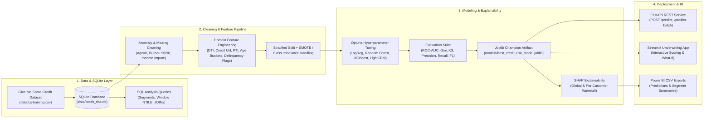
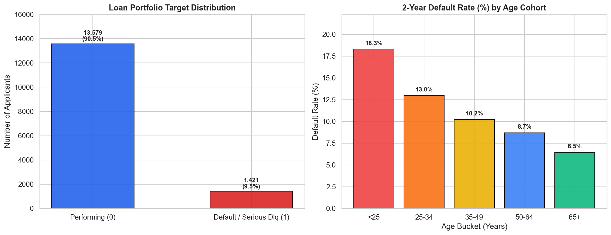
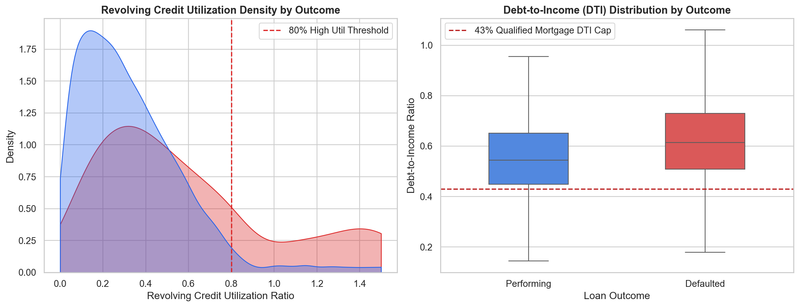
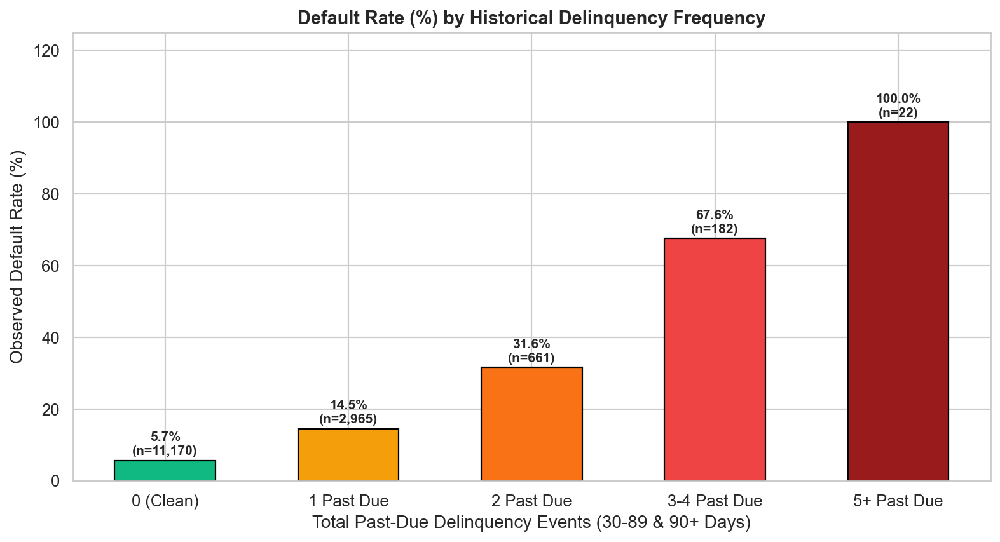
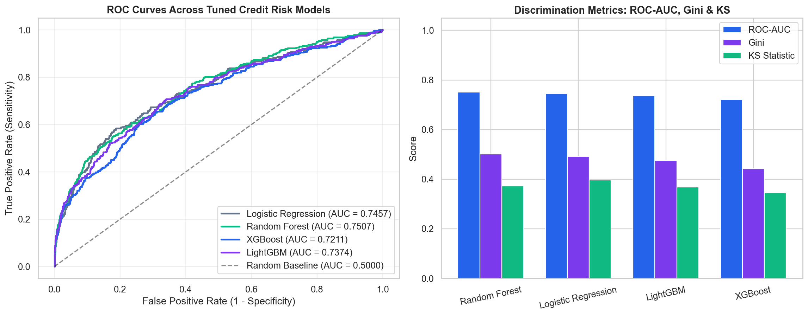
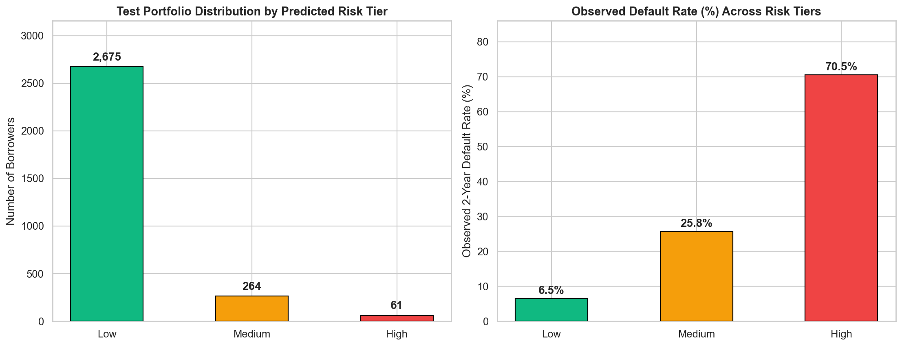
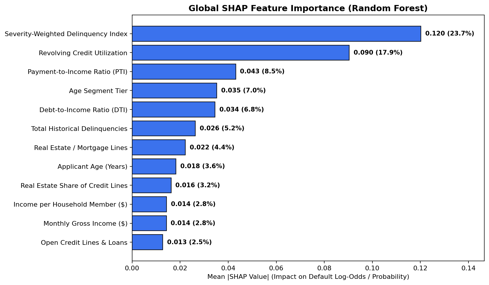
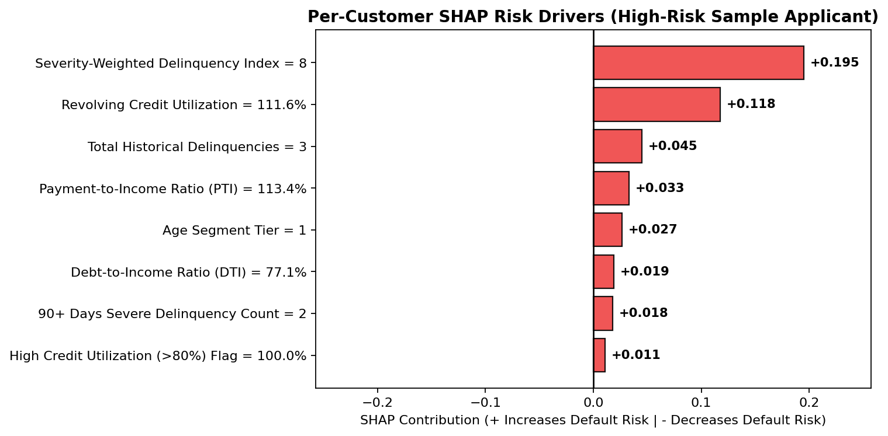

# 🛡️ End-to-End AI Credit Risk Prediction & SHAP Underwriting Platform

An enterprise-grade machine learning system in Python that predicts 2-year borrower default probability (`SeriousDlqin2yrs`), classifies loan applicants into **Low**, **Medium**, or **High** risk tiers using configurable thresholds, explains individual underwriting decisions using **SHAP**, and exports governed datasets for **Power BI**.

---

## 🏗️ System Architecture



---

## 📁 Project Folder Structure

```text
AI Credit Risk Prediction/
├── data/
│   ├── cs-training.csv                  # Kaggle 'Give Me Some Credit' dataset (15,000 applicants)
│   ├── credit_risk_processed.csv        # Cleaned & feature-engineered dataset
│   └── credit_risk.db                   # Relational SQLite database (applicants, loan_applications, regional_macro)
├── sql/
│   ├── schema.sql                       # Relational schema & indexes
│   └── analysis_queries.sql             # Segment default rates, window functions (NTILE, RANK), and multi-table JOINs
├── notebooks/
│   └── 01_credit_risk_walkthrough.ipynb # Interactive EDA, SQL, modeling & SHAP walkthrough
├── src/
│   ├── config.py                        # Configurable RiskThresholds (Low/Medium/High) & pipeline config
│   ├── data_generator.py                # Dataset loader / realistic Give Me Some Credit synthesizer
│   ├── database.py                      # SQLite database builder & SQL query runner
│   ├── feature_engineering.py           # Stateful data cleaning & credit domain feature engineering
│   ├── preprocessing.py                 # Stratified train/test split, StandardScaler, SMOTE & class weights
│   ├── eda.py                           # Automated Exploratory Data Analysis (EDA) chart suite
│   ├── model_training.py                # Logistic Regression, Random Forest, XGBoost, LightGBM + Optuna tuning
│   ├── explainability.py                # Global & per-customer SHAP explainability engine
│   ├── bi_export.py                     # Power BI CSV exporter (customer drill-down & cohort summaries)
│   └── pipeline.py                      # End-to-end master pipeline orchestrator
├── api/
│   ├── schemas.py                       # Pydantic request/response schemas
│   └── main.py                          # FastAPI service (/health, /model-info, /predict, /predict-batch)
├── app/
│   └── streamlit_app.py                 # Interactive Streamlit underwriting studio & What-If simulator
├── models/
│   ├── best_credit_risk_model.joblib    # Self-contained Joblib artifact (model, feature engineer, scaler, SHAP)
│   └── model_comparison_metrics.json    # Benchmark evaluation metrics JSON
├── dashboard/
│   ├── predictions_export.csv           # Customer-level predictions, scores, tiers & top SHAP reasons
│   ├── segment_summary.csv              # Aggregated segment summaries for Power BI
│   ├── model_performance.csv            # Model comparison metrics for Power BI
│   ├── shap_global_importance.csv       # Global SHAP importance table for Power BI
│   ├── POWER_BI_GUIDE.md                # Power BI star schema, DAX measures & 4-page layout guide
│   └── figures/                         # Publication-grade EDA, ROC/KS, Risk Tier & SHAP charts
├── tests/
│   ├── test_features.py                 # Unit tests for data cleaning & engineered features
│   ├── test_sql.py                      # Unit tests for SQLite database & SQL queries
│   ├── test_models.py                   # Unit tests for metrics, risk tiers, Joblib artifact & SHAP
│   └── test_api.py                      # FastAPI integration tests
├── requirements.txt
├── Dockerfile
└── README.md
```

---

## ⚙️ Engineered Credit Risk Features

| Feature Name | Category | Formula / Domain Logic |
| :--- | :--- | :--- |
| `credit_utilization` | Revolving Credit | Cleaned `RevolvingUtilizationOfUnsecuredLines` capped at `2.0` |
| `debt_to_income` | Leverage | Cleaned `DebtRatio` normalized against imputed `MonthlyIncome` when raw dollar debt was recorded |
| `payment_to_income` | Cashflow Stress | Estimated minimum monthly debt service divided by `MonthlyIncome` |
| `age_bucket` / `age_bucket_code` | Lifecycle Cohort | `<25`, `25-34`, `35-49`, `50-64`, `65+` |
| `total_delinquencies` | Delinquency History | Sum of `30-59`, `60-89`, and `90+` days past due events (after cleaning special bureau codes `96`/`98`) |
| `weighted_delinquency_score` | Delinquency Severity | `1.0 × (30-59 DPD) + 2.0 × (60-89 DPD) + 3.5 × (90+ DPD)` |
| `any_delinquency_flag` | Binary Flag | `1` if `total_delinquencies > 0` else `0` |
| `severe_delinquency_flag` | Binary Flag | `1` if `NumberOfTimes90DaysLate > 0` else `0` |
| `high_utilization_flag` | Binary Flag | `1` if `credit_utilization > 80%` else `0` |
| `high_dti_flag` | Binary Flag | `1` if `debt_to_income > 43%` (Qualified Mortgage cap) else `0` |
| `income_per_dependent` | Household Capacity | `MonthlyIncome / (1 + NumberOfDependents)` |
| `real_estate_loan_ratio` | Collateral Mix | `NumberRealEstateLoansOrLines / (1 + NumberOfOpenCreditLinesAndLoans)` |

---

## 📊 Model Benchmark Results

All four models were trained on the stratified training split with **SMOTE** class-imbalance handling and tuned via **Optuna** stratified cross-validation:

| Model | ROC-AUC | Gini Coefficient | KS Statistic | Precision | Recall | F1-Score |
| :--- | :---: | :---: | :---: | :---: | :---: | :---: |
| **Random Forest (Champion)** | **0.7507** | **0.5015** | 0.3733 | 0.3415 | **0.3908** | **0.3645** |
| **Logistic Regression (Baseline)** | 0.7457 | 0.4913 | **0.3971** | 0.4485 | 0.2148 | 0.2905 |
| **LightGBM (Optuna Tuned)** | 0.7374 | 0.4749 | 0.3686 | **0.5472** | 0.2042 | 0.2974 |
| **XGBoost (Optuna Tuned)** | 0.7211 | 0.4421 | 0.3453 | 0.5278 | 0.2007 | 0.2908 |

### Configurable Risk Tier Thresholds
Predicted 2-year default probabilities (`predicted_pd`) are mapped into actionable underwriting tiers (configurable in `src/config.py`, FastAPI request body, or Streamlit sidebar):
* 🟢 **Low Risk (`PD < 20%`)**: Auto-Approve with standard prime terms.
* 🟡 **Medium Risk (`20% ≤ PD < 50%`)**: Manual underwriting review / risk-adjusted pricing.
* 🔴 **High Risk (`PD ≥ 50%`)**: Decline application or require secured collateral.

---

## 🖼️ Visual Gallery & SHAP Explainability

### 1. Portfolio Target Distribution & Age Cohort Default Rates


### 2. Credit Utilization & Debt-to-Income (DTI) Distributions


### 3. Historical Delinquency Frequency Impact


### 4. Model ROC Curves, Gini & KS Benchmark Comparison


### 5. Risk Tier Separation (Low, Medium, High)


### 6. Global SHAP Feature Importance


### 7. Per-Customer Local SHAP Explanation


---

## 🚀 Quickstart & Setup Instructions

### 1. Install Dependencies
```bash
pip install -r requirements.txt
```

### 2. Run the End-to-End Data, SQL, Training, SHAP & BI Pipeline
```bash
python -m src.pipeline
```

### 3. Run the Test Suite (`pytest`)
```bash
pytest -v
```

### 4. Start the FastAPI Prediction Service
```bash
uvicorn api.main:app --host 0.0.0.0 --port 8000 --reload
```
Example `POST /predict` request:
```bash
curl -X POST "http://localhost:8000/predict" \
  -H "Content-Type: application/json" \
  -d '{
    "RevolvingUtilizationOfUnsecuredLines": 0.85,
    "age": 31,
    "NumberOfTime30-59DaysPastDueNotWorse": 1,
    "DebtRatio": 0.48,
    "MonthlyIncome": 4100.0,
    "NumberOfOpenCreditLinesAndLoans": 6,
    "NumberOfTimes90DaysLate": 0,
    "NumberRealEstateLoansOrLines": 0,
    "NumberOfTime60-89DaysPastDueNotWorse": 0,
    "NumberOfDependents": 2,
    "low_risk_threshold": 0.20,
    "medium_risk_threshold": 0.50
  }'
```

### 5. Launch the Interactive Streamlit App
```bash
streamlit run app/streamlit_app.py
```

### 6. Power BI Dashboard Integration
Open Power BI Desktop and load the CSV files generated in `dashboard/`:
* `dashboard/predictions_export.csv`
* `dashboard/segment_summary.csv`
* `dashboard/model_performance.csv`
* `dashboard/shap_global_importance.csv`

See [`dashboard/POWER_BI_GUIDE.md`](dashboard/POWER_BI_GUIDE.md) for the complete star schema relationships, DAX measures, and 4-page layout specification.
