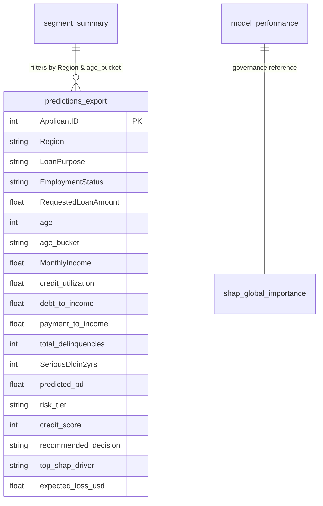

# Power BI Credit Risk Analytics & Model Governance Dashboard Guide

This guide provides step-by-step instructions for importing the exported CSV datasets from `dashboard/` into Microsoft Power BI to build an executive credit underwriting dashboard.

---

## 1. Data Sources Overview

The pipeline automatically exports the following files into the `dashboard/` directory:

| Filename | Purpose | Primary Key / Granularity |
| :--- | :--- | :--- |
| `predictions_export.csv` | Scored loan applicants with risk tiers, FICO scores, probabilities, and top SHAP reasons | `ApplicantID` (Grain: 1 row per applicant) |
| `segment_summary.csv` | Pre-aggregated cohort metrics (Volume, Defaults, Avg PD, Exposure, Expected Loss) | `Region` + `age_bucket` + `LoanPurpose` + `risk_tier` |
| `model_performance.csv` | Benchmark metrics (ROC-AUC, Gini, KS, Precision, Recall, F1) across all 4 models | `Model` |
| `shap_global_importance.csv` | Global feature importance and relative attribution percentages | `feature` |
| `sql_default_by_age_segment.csv` | Segment metrics derived from SQLite database analysis | `age_segment` |
| `sql_window_utilization_deciles.csv` | Decile-level utilization with cumulative default capture (Lift / KS curve) | `utilization_decile` |

---

## 2. Power BI Data Model Architecture (Star Schema)

Connect the tables in the Power BI Model View as follows:



---

## 3. Essential DAX Measures

Create a dedicated `_Measures` table in Power BI and paste the following DAX calculations:

```dax
// 1. Total Application Volume
Total Applications = COUNTROWS(predictions_export)

// 2. Total Loan Exposure ($)
Total Portfolio Exposure = SUM(predictions_export[RequestedLoanAmount])

// 3. Observed 2-Year Default Rate (%)
Observed Default Rate % =
DIVIDE(
    CALCULATE(COUNTROWS(predictions_export), predictions_export[SeriousDlqin2yrs] = 1),
    COUNTROWS(predictions_export),
    0
) * 100

// 4. Mean Predicted Probability of Default (%)
Average Predicted PD % = AVERAGE(predictions_export[predicted_pd]) * 100

// 5. Total Expected Loss ($)
Total Expected Loss = SUM(predictions_export[expected_loss_usd])

// 6. Expected Loss Rate (%)
Expected Loss Rate % = DIVIDE([Total Expected Loss], [Total Portfolio Exposure], 0) * 100

// 7. Low Risk Share (%)
Low Risk Share % =
DIVIDE(
    CALCULATE(COUNTROWS(predictions_export), predictions_export[risk_tier] = "Low"),
    COUNTROWS(predictions_export),
    0
) * 100

// 8. High Risk Share (%)
High Risk Share % =
DIVIDE(
    CALCULATE(COUNTROWS(predictions_export), predictions_export[risk_tier] = "High"),
    COUNTROWS(predictions_export),
    0
) * 100

// 9. Average Implied Credit Score
Average Credit Score = ROUND(AVERAGE(predictions_export[credit_score]), 0)
```

---

## 4. 4-Page Dashboard Layout Blueprint

### Page 1: Executive Portfolio Overview
* **KPI Cards (Top Banner):**
  * `Total Applications` (e.g., 15,000)
  * `Total Portfolio Exposure` ($185M)
  * `Average Predicted PD %` (7.4%)
  * `Total Expected Loss` ($8.9M)
  * `Average Credit Score` (714)
* **Visual 1 (Donut Chart):** Volume Distribution by `risk_tier` (Low = Green, Medium = Amber, High = Red).
* **Visual 2 (Clustered Column Chart):** `Total Exposure ($)` and `Expected Loss ($)` across `Region`.
* **Visual 3 (Line Chart):** Actual Default Rate vs Average Predicted PD by `age_bucket` (validating risk calibration).
* **Slicers:** `Region`, `EmploymentStatus`, `LoanPurpose`.

### Page 2: Risk Segment & Cohort Deep-Dive
* **Visual 1 (Matrix Table):** Rows = `age_bucket`, Columns = `risk_tier`, Values = `Total Applications`, `Observed Default Rate %`, `Average Predicted PD %`.
* **Visual 2 (Scatter Plot):** X-axis = `credit_utilization`, Y-axis = `debt_to_income`, Size = `RequestedLoanAmount`, Color = `risk_tier`.
* **Visual 3 (Bar Chart):** Delinquency Severity Breakdown (`total_delinquencies`) vs Default Probability.
* **Slicers:** `LoanPurpose`, `EmploymentStatus`.

### Page 3: Model Governance & Discrimination
* **Visual 1 (Table):** Benchmark comparison from `model_performance.csv` (Model, ROC-AUC, Gini, KS Statistic, Precision, Recall, F1).
* **Visual 2 (Horizontal Bar Chart):** Global SHAP feature importance from `shap_global_importance.csv` (`display_name` by `relative_importance_pct`).
* **Visual 3 (Cumulative Line Chart):** Lift and cumulative default capture from `sql_window_utilization_deciles.csv`.

### Page 4: Loan Underwriter Customer Drill-Down
* **Search / Filter Panel:** Filter by `ApplicantID`, `risk_tier`, `credit_score` range.
* **Applicant Summary Card:** Selected Applicant's Income, Utilization, DTI, Risk Tier, and Recommended Underwriting Decision.
* **SHAP Driver Breakdown:** Horizontal Bar chart showing the applicant's top risk-increasing and risk-reducing factors.
* **Detailed Record Grid:** Detailed table of filtered applications with export-to-Excel capability.
